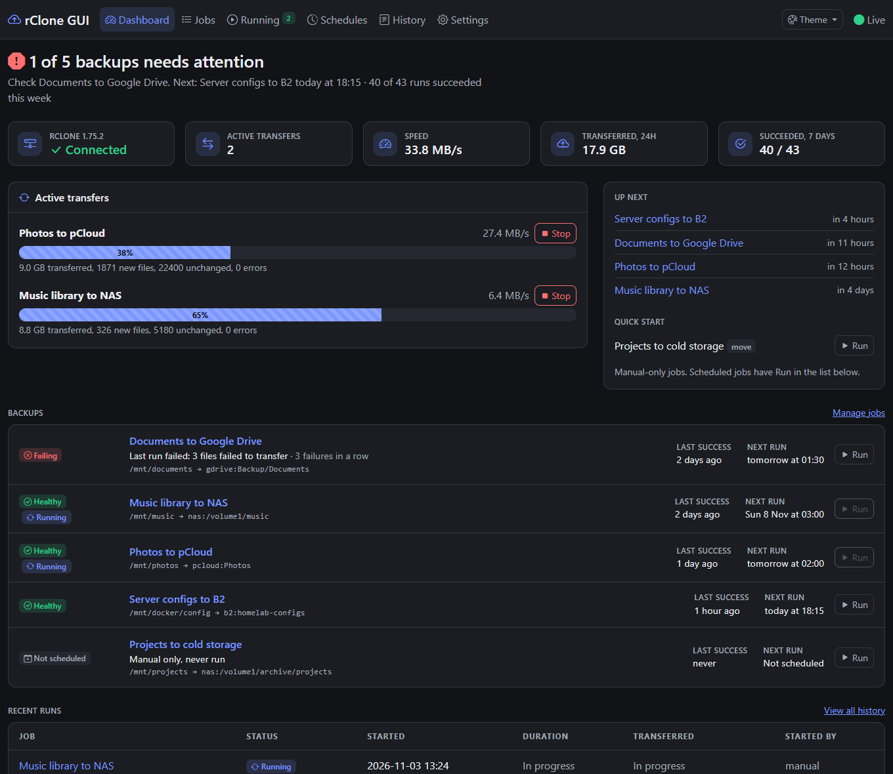
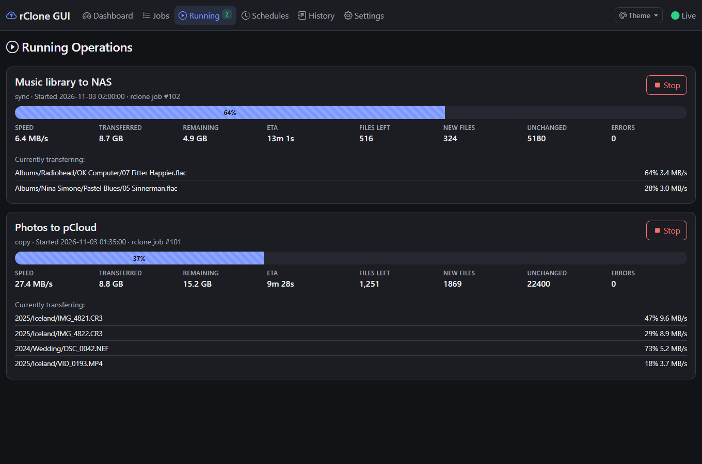
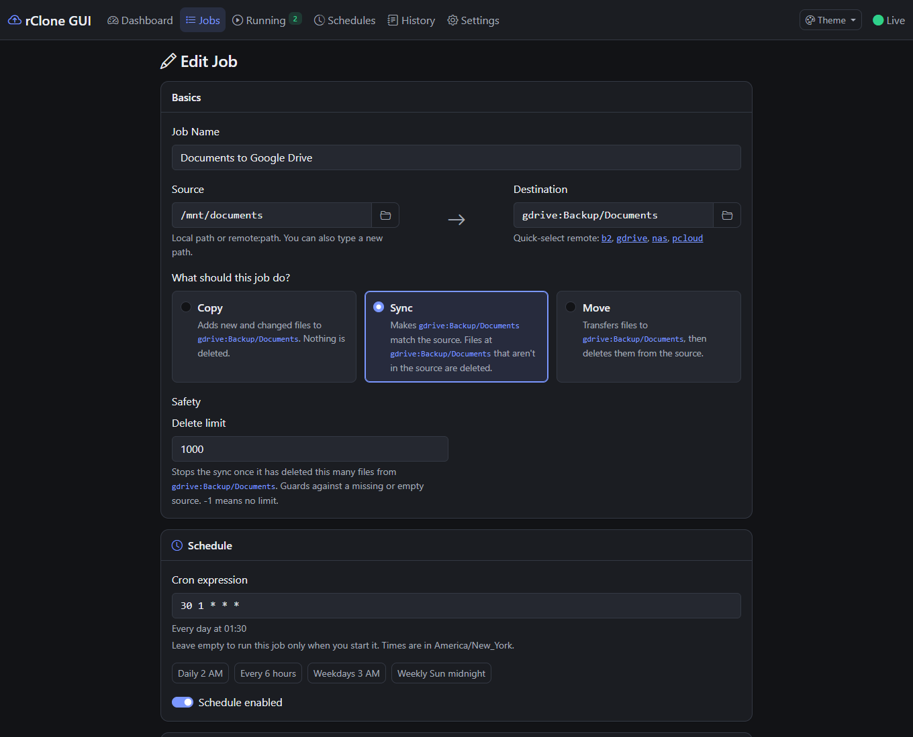
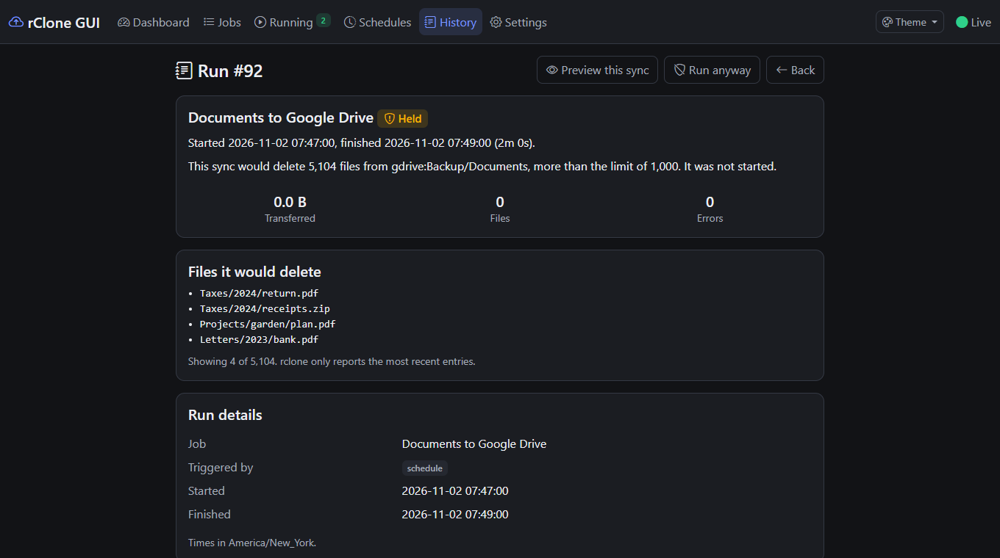
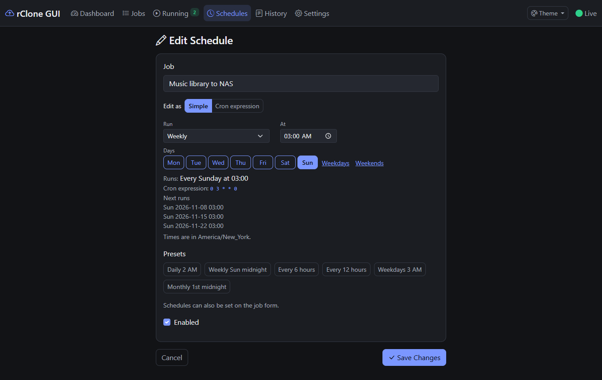
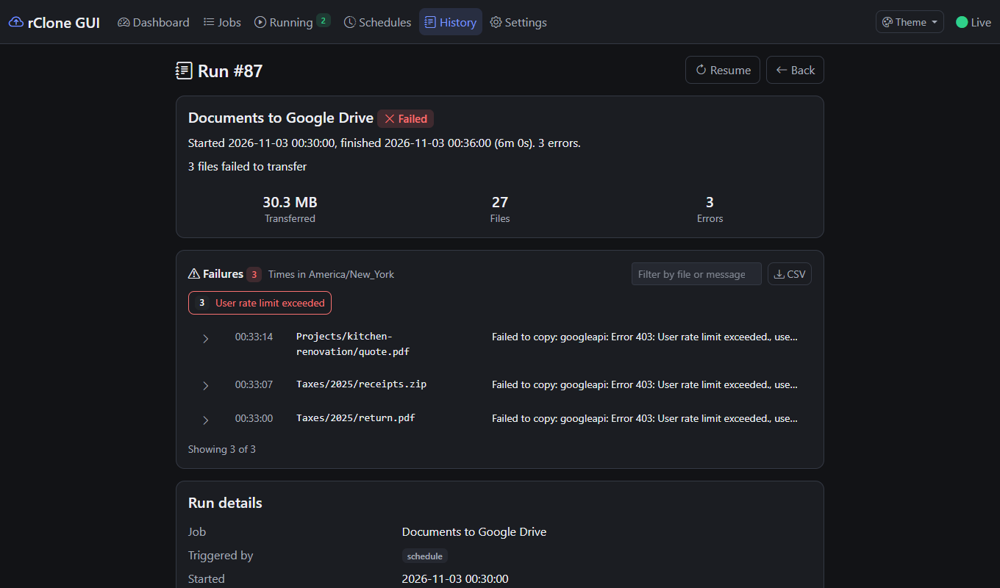
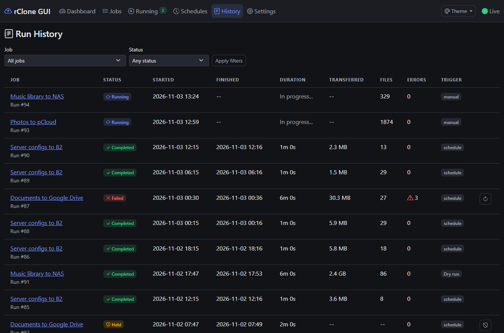

# rClone GUI

## Why this exists

rclone is an excellent tool for moving data to and from cloud storage, but
running it on a schedule means editing command lines and cron files by hand. I
wanted a web interface for it that I could deploy on my own homelab server, and
I couldn't find a good option.

So I built this one, functionality first. Anything rclone can do for a sync,
copy or move, you can set from the job form without dropping to a terminal:
exclude patterns, extra flags, per-job bandwidth, file comparison method and
transfer ordering. Every option has a default, so a basic job needs a name, a
source and a destination.

One backup job can hold a few huge files and thousands of small ones, and the
order rclone transfers them in decides whether the big files drag on at the end
or the small ones wait behind them. The job form lets you set that order (see
[Why size + mixed ordering?](#why-size--mixed-ordering)), and the dashboard and
failure list stay readable with thousands of files in a run.

It runs in Docker on a home server, or as a Windows app on a desktop PC. Both
use the same web UI.

> [!CAUTION]
> Anyone who can log in can browse the mounted filesystem, create jobs, and run
> `sync`/`move` operations against your data, which Docker mounts **read-write**.
> Login is on by default: the first visit asks you to choose a password.
>
> - Docker publishes the port on `127.0.0.1` only, unless you change it.
> - Only set `BIND_ADDRESS=0.0.0.0` on a network you trust.
> - **Never put it on the internet as is.** For remote access, use a VPN
>   (WireGuard, Tailscale) or a reverse proxy that enforces authentication.
>   See [Security notes](#security-notes).
> - `AUTH_MODE=none` turns login off. You have to set it on purpose.

rClone GUI is a Flask web app for managing [rclone](https://rclone.org) backup
jobs, on a home server with Docker or on a Windows PC as a
[tray app](#windows-app). You create sync, copy and move jobs, schedule them,
watch transfers live and look back through run history, in a browser or in the
Windows app's own window. The app also checks that each backup runs on time and
succeeds, and tells you when one doesn't.

It is a standalone app, separate from the upstream rclone web GUI. It never
shells out to rclone: every operation goes through the **rclone RC HTTP API**.



<table>
  <tr>
    <td></td>
    <td></td>
  </tr>
  <tr>
    <td></td>
    <td></td>
  </tr>
  <tr>
    <td></td>
    <td></td>
  </tr>
</table>

*(The screenshots use demo data from a stub rclone.)*

## Features

- **Dashboard.** The first line answers "did my backups run?", for example
  "1 of 4 backups needs attention", followed by what to check and the next
  scheduled run. Under that are cards for rclone's connection and version,
  active transfers, current speed, data transferred in the last 24 hours and
  the 7-day success count. Live transfers sit next to **Up next** (the next
  scheduled runs) and **Quick start** (Run buttons for jobs with no schedule).
  Below, each job shows its state, the reason, its last success and next run,
  and a **Run** button. Problems sort to the top.
- **Jobs.** Sync, copy and move jobs between local paths and remotes. The form
  starts with the basics (name, source, destination, and what the job does)
  and keeps the rclone tuning in a collapsed **Advanced rclone options**
  section. New jobs default to **Copy**. Each mode spells out what it will do
  to the destination you typed, so you see that a sync deletes files at
  `gdrive:Backup/Documents` before you save it.
- **Advanced options.** Exclude patterns, per-job bandwidth rules, transfers
  and checkers, `--retries`, fast list, the file comparison method (default,
  `--size-only`, `--checksum`, `--ignore-existing`) and `--order-by`
  (`size`/`name`/`modtime`, `asc`/`desc`/`mixed` with a window %). The default
  ordering, **size + mixed**, keeps small and large files moving together. See
  [Why size + mixed ordering?](#why-size--mixed-ordering)
- **Extra flags.** Type any other rclone flag the way you would on the command
  line, one per line (`--max-backlog 200000`, `--buffer-size=32M`). The app
  checks each flag against the options your rclone knows before it saves the
  job and names any it rejects: unknown flags, flags the form already sets,
  filter flags (use the exclude field), and flags that would wait for input in a
  background run.
- **Directory browser.** The folder button next to source and destination walks
  local paths and remotes through `operations/list`.
- **Dry run.** The **Dry run** button on any job runs it with rclone's
  `--dry-run`. Nothing changes; the run's page says what it would have done
  ("It would copy 86 files (2.4 GB) and delete 12 files"). Dry runs show as
  "Dry run" in history and never count toward backup health.
- **Schedules.** Give a job a schedule on the job form, or on the Schedules
  page. **Simple** mode picks every N minutes or hours, daily, weekly (by day)
  or monthly, without writing cron. **Cron expression** mode takes any 5-field
  expression. Both show the schedule in plain words ("Every Sunday at 03:00")
  with the next three run times, and the app interprets it in your `TIMEZONE`. If a run comes
  due while the server is down, Docker starts it when it is less than an hour
  late; the Windows app starts one catch-up run for everything it missed.
- **Running page.** Live progress over SSE: speed, data transferred and
  remaining, ETA, files left, new and unchanged files, errors, and the files in
  flight. **Stop** asks before it stops a run.
- **Failures.** The app saves the error for each failed file while the run is
  still going. The Running page shows the newest failures as
  they happen. A run's page puts its failures first, grouped by cause, with a
  filter, paging and CSV export, and shows every time in your `TIMEZONE`. Each
  run keeps up to 50,000 failures.
- **Backup health.** Each job has one of these states. `GET /api/health`
  returns the same data as JSON.
  - `failing`: a run failed, or a safety check held one, since the last
    success.
  - `overdue`: no success by the deadline. For a scheduled job, the deadline is
    the first cron time after the last success plus 60 minutes of grace. A
    running job is not overdue against its schedule. A per-job "Must succeed at
    least every N hours" sets the deadline instead.
  - `warning`: the last successful run deleted more than 100 files and more
    than ten times the usual number (the median of the ten runs before it).
  - `healthy`: the job succeeded on time.
  - `pending`: the job has a schedule or a deadline and hasn't succeeded yet.
  - `manual` (shown as "Not scheduled"): no enabled schedule and no deadline, so
    the app expects nothing. Its detail line still says what happened last, for
    example "Last run was stopped 9 days ago · never succeeded".
- **Safety checks.** Before a sync starts, the app reads its source and counts
  how many files the sync would delete. If the source is unreadable or empty,
  or the count is over the job's delete limit (default 1000 files), the app
  holds the run (`held`) and nothing is deleted. A held run lists the files it
  would delete and has **Preview this sync** and **Run anyway** buttons. See
  [Keeping backups safe](#keeping-backups-safe).
- **Skipped runs.** If a schedule fires while the job's previous run is still
  going, the app records a `skipped` run instead of dropping it.
- **Notifications.** Alerts go through [Apprise](https://github.com/caronc/apprise)
  to ntfy, Discord, Telegram, email, Gotify and 100+ more. You choose the events
  on the Settings page. Failure messages list the top causes. **Send test
  notification** sends to the URLs in the box without saving the rest of the
  page.
- **Heartbeat.** The app pings a dead-man's-switch URL (Healthchecks.io, an
  Uptime Kuma push monitor) every N minutes while it and rclone are working. If
  either one dies, the pings stop and your monitor alerts you.
- **Login.** A single password by default. Behind a reverse proxy (Authelia,
  Authentik, oauth2-proxy), the app can trust the proxy's login instead. See
  [Security notes](#security-notes).
- **History.** Every run keeps its final stats, status
  (`completed`/`failed`/`stopped`/`interrupted`/`held`/`skipped`), deletes,
  checks and the exact settings it used. Filter by job and status, 50 runs per
  page; the filtered URL is shareable.
- **Auto-resume.** A per-job toggle. On restart, the app re-dispatches runs
  still marked `running`. Failed runs retry after a delay, up to
  `max_retries` (default 3), and each retry becomes a new history record linked
  through `retry_of_run_id`. A run you stopped never resumes on its own. Failed
  and interrupted runs have a manual **Resume** button.
- **Remotes.** Settings lists your rclone remotes, adds new ones with guided
  setup for every storage type rclone supports (including browser sign-in for
  Google Drive, OneDrive and Dropbox), and deletes ones you no longer use.
  Deleting a remote leaves the files on it alone.
- **Bandwidth limits.** Any number of weekly rules, each with days, a time
  window (overnight windows work) and a speed in KiB/s, MiB/s, GiB/s or Mbit/s.
  Set them per job, or for the whole app in Settings, where a rule can cover
  everything, all remotes (including ones you add later) or specific remotes. A job uses a
  remote if its source or destination is on it. Where rules overlap, the lowest
  limit wins. rclone has one speed limiter shared by all its transfers, so the
  app updates it as runs start and stop and as windows open and close. Jobs
  running at the same time share the lowest limit that applies to any of them.
  Rules use `TIMEZONE`.
- **Themes.** Six themes (Graphite, Liquid Glass, Keycaps, Terminal, Synthwave,
  Brutalist), each in light, dark or system mode, from the **Theme** menu. Each
  browser keeps its own choice. The themes change the look of the chrome;
  tables, paths and forms stay calm enough to read in all of them.
- **Accessibility.** Text passes WCAG AA contrast in all six themes, light and
  dark. Icon buttons carry screen-reader names that include the job, keyboard
  focus stays visible, and screen readers hear when a run starts or finishes.

## Keeping backups safe

`rclone sync` makes the destination match the source, so it deletes files there
that the source no longer has. If the source disappears (a dropped NFS or SMB
mount, an unplugged drive), it can look empty, and a sync would delete the whole
backup.

Three checks stop that:

- **Source check.** Before a sync starts, the app lists the top level of the
  source. If that fails or comes back empty, the app **holds** the run: rclone
  never starts, and the run page says why.
- **Deletion count.** Next, the app runs the same sync as a dry run and counts
  the files it would delete. If the count is over the job's delete limit
  (default 1000, set per job), the app holds the run before anything is
  deleted. The run page gives the count and lists up to 50 of the files. The
  Running page shows "Counting deletions" while this happens. The dry run scans
  both sides once more, so on very large remotes you can turn it off per job
  with **Count deletions before each run**.
- **Delete limit.** As a backstop, the app also passes the limit to rclone as
  `--max-delete`, so a sync stops once it has deleted that many files. A run
  that hits it is marked failed, with the reason. `-1` turns the limit off.

The app never retries a held or delete-limited run on its own, even with
auto-resume on. Check the run before you start the job again.

Copy and move jobs skip these checks, because they can't delete files at the
destination.

On a held run, **Preview this sync** starts a dry run so you can see what it
would do. **Run anyway** starts the job once with all three checks off, after
you confirm. Use it when you expect the deletions.

## Why size + mixed ordering?

Say a backup holds both huge files (videos, disk images) and thousands of tiny
ones (photos, documents, source code). The order rclone transfers them in
changes how the run goes:

| Order | What happens |
|-------|--------------|
| Default (directory order) | Arbitrary. Big files can start late and become a long tail at the end. |
| Largest first (`size,desc`) | Every worker is busy on huge files, so the small files wait in the queue. You see few "new files" for hours, and the per-file overhead (API calls, round trips) that could overlap with the big transfers goes unused. |
| Smallest first (`size,asc`) | Thousands of small files finish fast, but the huge files start at the end, so the run finishes on a few slow, bandwidth-bound transfers. |
| **Mixed (`size,mixed,50`)** | Half of the transfer workers take the **smallest** remaining file and the other half take the **largest**. Small files keep flowing while the big ones transfer. |

The mixed window is the percentage of workers that go smallest-first (default
`50`); the rest go largest-first, and each group keeps its direction for the
whole run. With `Transfers = 4` and `size,mixed,50`, two workers chew through
small files while two work on large ones. Use a lower percentage (say `25`) to
put most workers on the big files, or a higher one to finish the small files
sooner.

Set it per job under **Advanced rclone options**, in **Order By Field**, **Order
Direction** and **Mixed Window (%)**. The app passes it to rclone as
`--order-by size,mixed,50`. The split works across transfer workers, so it
works best with several parallel transfers, and rclone's docs note that a larger
`--max-backlog` makes the ordering more accurate.

## Windows app

A regular Windows program with its own window. It runs without Docker or Python
and includes rclone. Closing the window leaves it in the system tray so scheduled
syncs keep running; choose **Quit** from the tray icon's menu to exit.

1. Download `rClone-GUI-Setup.exe` from the
   [releases page](https://github.com/Joe11221/rClone-GUI/releases). You don't
   need admin rights. The installer is unsigned, so SmartScreen warns on first
   run: choose **More info**, then **Run anyway**.
2. Leave **Start rClone GUI when I log in** ticked if you want schedules to keep
   running.
3. Right-click the tray icon and choose **Configure remotes…** to add cloud
   remotes. The app picks up the rclone remotes you already have.

If the PC was asleep or off when a schedule came due, the app starts the job
once when it next runs, however many runs it missed. The PC stays awake during
a transfer, but the app can't wake a sleeping PC, and schedules only run while
you are logged in.

The Windows app has no login by default. It listens on loopback only and
expects one user. Other accounts on the same PC can still reach that port, so
on a PC shared with people you don't trust, turn login on. Open
`%LOCALAPPDATA%\rClone GUI\settings.json`, add `"auth_mode": "password"`, quit the
app from the tray, and start it again. The window then asks you to choose a
password.

The app keeps its data in `%LOCALAPPDATA%\rClone GUI` and leaves it in place on
uninstall. It doesn't support password-encrypted rclone configs yet.

See [docs/standalone-windows.md](docs/standalone-windows.md) for the design and
build steps.

## Quickstart (Docker)

You need Docker with the Compose plugin, and an existing rclone config
(`rclone config`) if you want to use cloud remotes.

```bash
cp .env.example .env
# Edit .env: TIMEZONE, RCLONE_CONFIG, DATA_PATH, (PORT, BIND_ADDRESS)
docker compose up -d --build
```

Then open `http://127.0.0.1:${PORT}` (default `8080`). The first visit asks you
to choose a password, so do that before anyone else can reach the port. The
container restarts unless you stop it (`unless-stopped`).

`SECRET_KEY` is optional. If you leave it empty, the app generates one on first
start and keeps it in `./data`, so logins survive restarts. The app refuses
placeholder values such as `change-me`.

### Configuration (`.env`)

| Key | Default | Description |
|-----|---------|-------------|
| `SECRET_KEY` | generated | Signs login sessions. Leave empty to have one generated and saved in `./data`, or set a long random value (`python3 -c "import secrets; print(secrets.token_hex(32))"`). The app refuses placeholder values. |
| `AUTH_MODE` | `password` | `password`: one password, chosen on first visit. `proxy`: trust the login from a reverse proxy (see [Security notes](#security-notes)). `none`: no login at all. |
| `AUTH_PROXY_HEADER` | `Remote-User` | Header the reverse proxy sets to the logged-in user. Only used when `AUTH_MODE=proxy`. |
| `SECURE_COOKIES` | `false` | Set to `true` when you serve the app over https, so the browser never sends the login cookie over plain http. |
| `PUBLIC_URL` | (none) | Base address for links in notifications, e.g. `http://nas.lan:8080`. The value saved on the Settings page takes precedence. `docker-compose.yml` passes it through. |
| `PORT` | `8080` | Host port for the web GUI |
| `BIND_ADDRESS` | `127.0.0.1` | Host address Docker publishes the port on. `0.0.0.0` exposes it to your whole network; see the warning above. |
| `TIMEZONE` | `UTC` | IANA timezone (e.g. `America/New_York`) used to display times **and** to interpret cron schedules |
| `RCLONE_CONFIG` | `~/.config/rclone` | Host path to the rclone config directory (where your remotes live) |
| `DATA_PATH` | `/mnt/storage` | Host data path, mounted at `/mnt/` inside the container |
| `ALLOWED_HOSTS` | any | Comma-separated `host:port` values the app answers to, e.g. `nas.lan:9020`. Setting it blocks DNS rebinding attacks |

Example for a home server you want to reach from other machines on your LAN:

```ini
PORT=9020
BIND_ADDRESS=0.0.0.0
TIMEZONE=America/New_York
DATA_PATH=/mnt
```

### Volumes

- `./data` -> `/app/instance`: SQLite database (gitignored)
- `${RCLONE_CONFIG}` -> `/root/.config/rclone`: rclone remotes and config. It
  holds your cloud credentials; keep it out of version control.
- `${DATA_PATH}` -> `/mnt/` (**read-write**): the host data hierarchy. The
  container can write to everything under `DATA_PATH`, and `move` jobs to local
  destinations need that. Point it at the narrowest directory that works for
  you.

### Upgrading

If you ran an earlier build from this repository:

- The first visit asks you to choose a password. To keep the old no-login
  behaviour, set `AUTH_MODE=none` in `.env` and restart.
- Existing sync jobs get a delete limit of 1000 files. If a job needs to delete
  more than that in one run, raise the limit on the job form, or set it to `-1`
  for no limit. The app marks a run that hits the limit as failed, and **Run
  anyway** starts it once without the limit.
- Jobs with no enabled schedule and no "Must succeed" deadline now show as
  `manual` ("Not scheduled") instead of `pending`. `/api/health` has a new
  `manual` count.
- Existing jobs keep their sync type. Only new jobs default to Copy.

The app creates and upgrades its database schema on startup
(`db.create_all()` plus `_ensure_columns()` in `app/__init__.py`), so you don't
run a separate migration step. `docker compose up -d --build` is enough.

If you ran a version without `TIMEZONE` in `docker-compose.yml`, cron schedules
used the container's clock (UTC) while the UI displayed `America/New_York`.
Schedules now run in `TIMEZONE`, so set it and check your cron expressions.

## Architecture

```
Browser <--HTTP/SSE--> Gunicorn (gevent, 1 worker) :8080 <--RC HTTP--> rclone rcd :5572
                              |
                          SQLite (./data)
```

`entrypoint.sh` starts both `rclone rcd` and Gunicorn in a single container.
rclone's RC API listens on `127.0.0.1` inside the container behind a password
generated on every start, so only the Flask app can reach it. (rclone only
allows adding remotes through an authenticated API.)

Key design rules:

- **The app shows only the runs it started.** It tracks runs in
  `JobRunner._active_runs`, and the SSE endpoint polls rclone per stats group
  (`core/stats?group=job_{run_id}`), never the global stats, so other rclone
  activity stays out of the UI.
- **All rclone operations are async** (`_async: true`) and return a `jobid`;
  the app never blocks on multi-hour transfers.
- **Each run gets a stats group** `job_{run_id}` for per-job metrics. SSE and
  the dashboard depend on this naming.
- **Gevent is mandatory** (SSE connections hold greenlets). `wsgi.py` calls
  `gevent.monkey.patch_all()` first; don't use stdlib `threading`/`queue`.
- **Gunicorn runs with `workers = 1`.** The in-memory `_active_runs` dict and
  the APScheduler monitor must live in a single process (see
  `gunicorn.conf.py`).

### How a run works

1. Start -> `POST /ops/start/<job_id>` -> `JobRunner.start_job()`
2. The runner creates a `RunHistory` row (status `running`). For a sync, it
   checks the source first and holds the run if the check fails. It then
   starts a dry run of the sync in `job_{run_id}_preview` (phase `preview`);
   the monitor reads its delete count and either holds the run or starts the
   real sync. rclone always runs with `_async=true` and `_group=job_{run_id}`
3. The SSE endpoint polls `core/stats?group=job_{run_id}` (every 2s while
   active, 5s when idle)
4. A 10-second monitor copies new per-file failures into the DB while a run is
   active, then finalizes completed runs and writes their final stats
5. Auto-resume (if enabled) re-dispatches orphaned and failed runs

### Project structure

```
app/
├── __init__.py           # App factory, dashboard view, startup checks, _ensure_columns() schema upgrades
├── auth.py               # Login (password / proxy / none), sessions, lockout, secret key
├── config.py             # Env-based config (SECRET_KEY, AUTH_MODE, TIMEZONE, RCLONE_RC_URL, ...)
├── extensions.py         # SQLAlchemy instance
├── models.py             # Job, Schedule, RunHistory, RunError, BandwidthRule, AppSetting (SQLite)
├── rclone_client.py      # HTTP wrapper for rclone RC API
├── routes/
│   ├── health.py         # GET /api/health: backup health as JSON
│   ├── jobs.py           # Job CRUD, inline schedule, directory browse API
│   ├── operations.py     # Start/stop/resume/status of running syncs
│   ├── schedules.py      # Cron schedule CRUD, enable/disable, cron_text filter
│   ├── history.py        # Run list (filters, paging) and run detail
│   ├── run_errors.py     # Per-run failure list (JSON, paged), summary, CSV export
│   ├── sse.py            # SSE endpoint; polls rclone directly (no background thread)
│   └── settings.py       # Remotes, bandwidth rules, notification and heartbeat settings
├── services/
│   ├── app_settings.py   # Key/value settings edited in the UI (stored in SQLite)
│   ├── bandwidth.py      # Weekly bandwidth rules and the single rclone speed limit
│   ├── cron_text.py      # Cron expressions in plain words ("Every day at 02:00")
│   ├── cron_trigger.py   # APScheduler triggers with cron's weekday numbering (0 = Sunday)
│   ├── events.py         # In-process event bus: run finished/held/skipped, health changed
│   ├── extra_flags.py    # Command-line flags <-> rclone _config keys, checked against options/info
│   ├── health.py         # Backup health rules, dashboard verdict, 7-day success rate
│   ├── job_runner.py     # Core orchestration: start/stop jobs, safety checks, finalize runs
│   ├── notifier.py       # Notifications (Apprise) and the heartbeat ping
│   ├── remotes.py        # Creating rclone remotes from the GUI, including OAuth sign-in
│   ├── run_errors.py     # Turns rclone transfer errors into stored, grouped failures
│   ├── scheduler_service.py  # APScheduler cron triggers and skipped-run records
│   └── suspects.py       # Suggests folders to exclude while a run is in progress
├── security.py           # Cross-site POST and ALLOWED_HOSTS checks
├── templates/            # Jinja2, Bootstrap 5 (themed via data-theme)
└── static/               # CSS, vendored Bootstrap, vanilla JS (SSE, job form, failures, themes)
desktop/                  # Windows app: WebView2 window, tray icon, rclone supervisor
packaging/                # PyInstaller spec, Inno Setup script, build.ps1
tests/                    # pytest suite (no rclone needed)
```

Tech stack: Flask 3.1, SQLAlchemy (SQLite), APScheduler 3.10, Apprise
(notifications), Gunicorn + gevent, Bootstrap 5 (vendored, no CDN) and vanilla
JS (no build tools). The Windows app adds pywebview, pystray, Pillow and
PyInstaller.

## Security notes

- **Login** (`AUTH_MODE`):
  - `password` (default): one shared password, chosen on the first visit. Login
    sessions last 30 days. Five failed attempts from one address lock that
    address out for 15 minutes. Changing the password on the Settings page signs
    out every other browser.
  - `proxy`: the app trusts the user named in the `AUTH_PROXY_HEADER` header
    (default `Remote-User`), which a reverse proxy such as Authelia, Authentik or
    oauth2-proxy sets after it logs the user in. Requests without the header get
    `401`. Only that proxy may reach the app's port; anyone else could send the
    header.
  - `none`: no login. The web UI shows a warning banner.
- **Lockouts are per client address.** Behind a reverse proxy in `password`
  mode, every client appears to come from the proxy's address, so one person's
  failed attempts lock everyone out for 15 minutes.
- **The app rejects cross-site requests** (`app/security.py`). It refuses a
  browser POST that another website sent, based on the `Sec-Fetch-Site` or
  `Origin` header. Requests without those headers (scripts, `curl`) skip that
  check, so they still need a login.
- Any user of the app can list arbitrary paths through the directory browser
  (`/jobs/api/browse`) and set rclone options through a job's extra flags. The
  app accepts only options your rclone reports, but those include powerful ones.
- Docker mounts the data path read-write, and the mounted rclone config holds your
  remote credentials.
- The published port defaults to loopback; you widen it on purpose with
  `BIND_ADDRESS`.
- The rclone RC API listens on loopback inside the container only, behind a
  per-start password.

Found a security problem? Open an issue, or contact the maintainer in private
for anything sensitive.

## Development

```bash
python -m venv .venv && source .venv/bin/activate   # Windows: .venv\Scripts\activate
pip install -r requirements-dev.txt
pytest
```

The tests use an in-memory SQLite database and a fake rclone client, and start
no background scheduler threads (`BACKGROUND_TASKS_ENABLED = False`). CI runs
the test suite and a Docker build on every push and pull request.

Gotchas:

- SQLite stores `exclude_patterns` and `extra_flags` as JSON strings; use
  `job.get_excludes()` / `job.get_extra_flags()`. `extra_flags` holds rclone
  `_config` keys (`{"MaxBacklog": 200000}`); `app/services/extra_flags.py`
  converts them to and from the command-line form the job form shows.
- Each run records the settings it started with (`config_snapshot`), shown under
  "Settings used for this run" on the run page. Runs from older builds have no
  snapshot, so for those the job's *current* settings are the only reference.
- A move can leave files half relocated if something interrupts it, so resuming it
  may not give a clean result; the job form warns when you combine move with auto-resume.
- New columns on existing tables need an `ALTER TABLE` entry in
  `_ensure_columns()`, because `create_all()` won't add them.
- APScheduler jobs run outside a request, so DB access needs
  `app.app_context()`.
- Untrusted text (file names, error messages, remote names) goes into the page
  with `textContent`, never `innerHTML`; `tests/test_frontend_safety.py`
  enforces this for the live views.

## License

[MIT](LICENSE)
