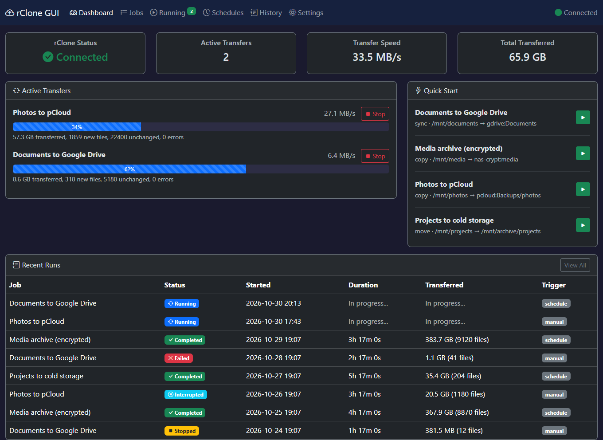
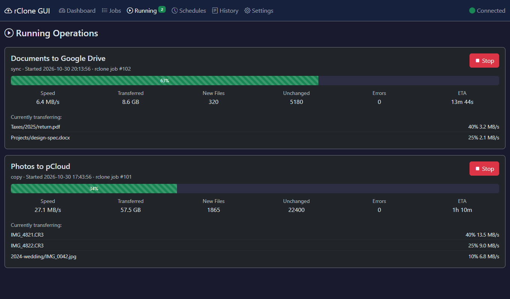
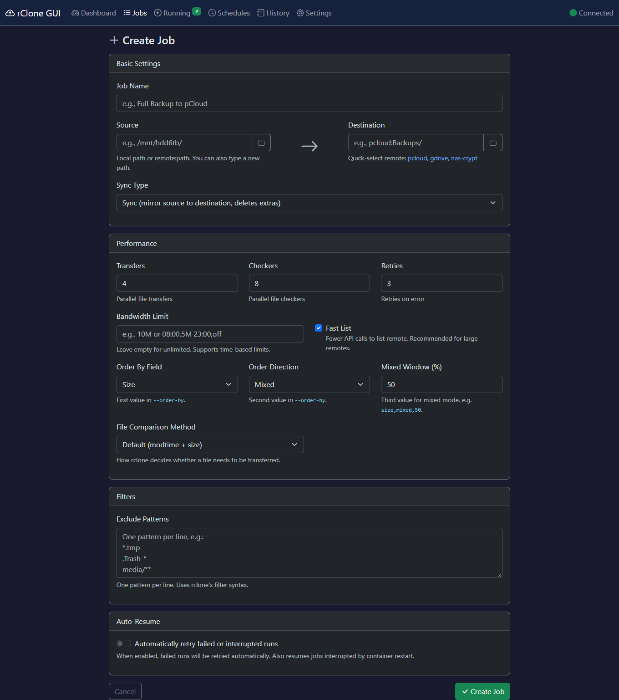
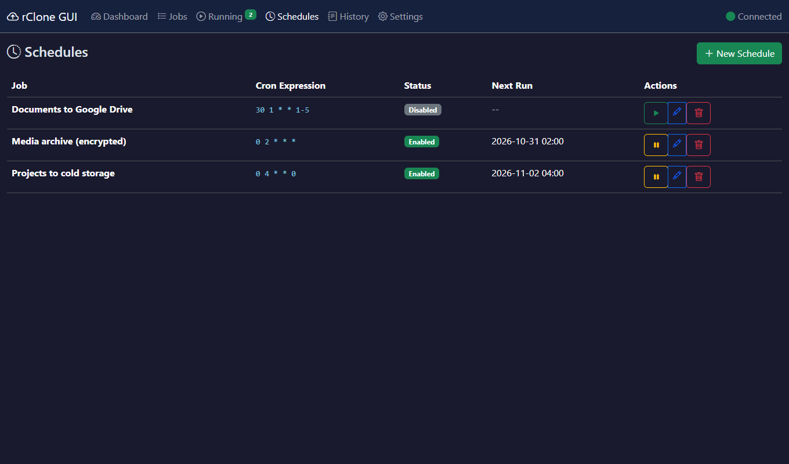
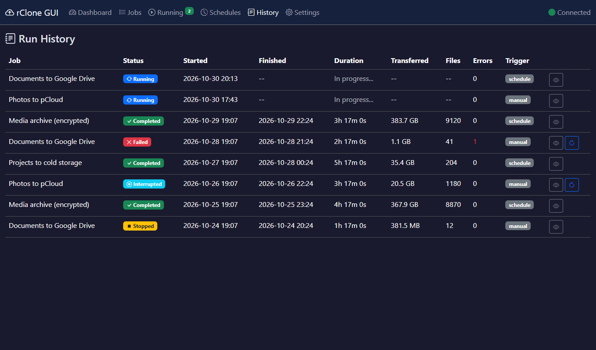

# rClone GUI

> [!CAUTION]
> **This app has no authentication and no CSRF protection.** Anyone who can
> reach its port can browse the mounted filesystem, create jobs, and run
> `sync`/`move` operations against your data (which is mounted **read-write**).
>
> - By default the port is published on `127.0.0.1` only.
> - Only set `BIND_ADDRESS=0.0.0.0` on a network you fully trust.
> - **Never expose it to the internet.** If you need remote access, put it
>   behind a VPN (WireGuard, Tailscale) or a reverse proxy that enforces
>   authentication.

A Flask web GUI for managing [rclone](https://rclone.org) backup jobs on a home
server. Create sync/copy/move jobs, schedule them with cron, watch live
transfer progress, and browse run history — all from a browser.

This is a standalone app (not the upstream rclone web GUI). It never shells out
to rclone; every operation goes through the **rclone RC HTTP API**.



<table>
  <tr>
    <td></td>
    <td></td>
  </tr>
  <tr>
    <td></td>
    <td></td>
  </tr>
</table>

*(Screenshots use demo data served by a stub rclone.)*

## Features

- **Jobs** — CRUD for sync/copy/move jobs with source/destination (local
  paths or remotes), exclude patterns, extra flags, per-job bandwidth, and
  `--order-by` composition (field `size`/`name`/`modtime`, direction
  `asc`/`desc`/`mixed` with a window %). The default, **size + mixed**, keeps
  small and large files moving at the same time — see
  [Why size + mixed ordering?](#why-size--mixed-ordering).
- **File comparison method** — per job: default (modtime + size),
  `--size-only`, `--checksum`, or `--ignore-existing`.
- **Directory browser** — the Browse button on the job form opens a modal
  that walks local paths and remotes via `operations/list`.
- **Schedules** — per-job cron schedules (APScheduler), enable/disable,
  interpreted in your configured `TIMEZONE`.
- **Live dashboard** — SSE-driven progress bars, speed, bytes, file counts
  (new vs unchanged), and ETA.
- **History** — every run is recorded with final stats and status
  (`completed`/`failed`/`stopped`/`interrupted`).
- **Auto-resume** — per-job toggle. Orphaned `running` records are
  re-dispatched on container restart; failed runs retry after a delay up to
  `max_retries` (default 3). Each retry is a new history record linked via
  `retry_of_run_id`. User-stopped runs are never auto-resumed. A manual
  Resume button is available on failed/interrupted runs.
- **Settings** — configured remotes list and a global bandwidth limit.

## Why size + mixed ordering?

If a backup contains both huge files (videos, disk images) and thousands of
tiny ones (photos, documents, source code), the order rclone transfers them in
matters a lot:

| Order | What happens |
|-------|--------------|
| Default (directory order) | Arbitrary. Big files can start late and become a long tail at the end. |
| Largest first (`size,desc`) | Every worker is busy on huge files, so the small files sit idle in the queue — you see few "new files" for hours, and per-file overhead (API calls, round trips) goes unused. |
| Smallest first (`size,asc`) | Thousands of small files finish quickly, but the huge files only start at the end, so the job's final stretch is a few slow, bandwidth-bound transfers. |
| **Mixed (`size,mixed,50`)** | Half of the transfer workers take the **smallest** remaining file, the other half take the **largest**. Small files keep flowing while the big ones are also being processed. |

The mixed window is the percentage of workers that go smallest-first (default
`50`); the rest go largest-first, and each group keeps its direction for the
whole run. For example, with `Transfers = 4` and `size,mixed,50`, two workers
chew through small files while two work on large ones. Use a lower percentage
(say `25`) if you want most workers on the big files, or a higher one if you
want small files to finish sooner.

Set it per job under **Order By Field / Order Direction / Mixed Window (%)** in
the job form; it is passed to rclone as `--order-by size,mixed,50`. Because the
split is across transfer workers, it works best with several parallel
transfers, and rclone's own docs note that ordering is more accurate with a
larger `--max-backlog`.

## Quickstart

Requires Docker with the Compose plugin, and an existing rclone config
(`rclone config`) if you want to use cloud remotes.

```bash
cp .env.example .env
python3 -c "import secrets; print(secrets.token_hex(32))"   # paste into SECRET_KEY
# Edit .env: SECRET_KEY, TIMEZONE, RCLONE_CONFIG, DATA_PATH, (PORT, BIND_ADDRESS)
docker compose up -d --build
```

Then open `http://127.0.0.1:${PORT}` (default `8080`). The container
auto-restarts (`unless-stopped`).

The container **refuses to start without a real `SECRET_KEY`**; placeholder
values are rejected.

### Configuration (`.env`)

| Key | Default | Description |
|-----|---------|-------------|
| `SECRET_KEY` | — (**required**) | Flask secret key. Generate a random value. |
| `PORT` | `8080` | Host port for the web GUI |
| `BIND_ADDRESS` | `127.0.0.1` | Host address the port is published on. `0.0.0.0` exposes it to your whole network — see the warning above. |
| `TIMEZONE` | `UTC` | IANA timezone (e.g. `America/New_York`) used to display times **and** to interpret cron schedules |
| `RCLONE_CONFIG` | `~/.config/rclone` | Host path to the rclone config directory (remotes are defined here) |
| `DATA_PATH` | `/mnt/storage` | Host data path, mounted at `/mnt/` inside the container |

Example for a home server you want to reach from other machines on your LAN:

```ini
PORT=9020
BIND_ADDRESS=0.0.0.0
TIMEZONE=America/New_York
DATA_PATH=/mnt
```

### Volumes

- `./data` -> `/app/instance` — SQLite database (gitignored)
- `${RCLONE_CONFIG}` -> `/root/.config/rclone` — rclone remotes/config. This
  contains your cloud credentials; keep it out of version control.
- `${DATA_PATH}` -> `/mnt/` (**read-write**) — the host data hierarchy.
  Note: this gives the container write access to everything under
  `DATA_PATH`; `move` operations to local destinations rely on this. Point it
  at the narrowest directory that works for you.

### Upgrading

The database schema is created and upgraded by the app itself on startup
(`db.create_all()` plus `_ensure_columns()` in `app/__init__.py`), so there is
no separate migration step. Just `docker compose up -d --build`.

If you previously ran a version where `TIMEZONE` was not set in
`docker-compose.yml`, note that cron schedules used the container's clock
(UTC) while times were displayed in `America/New_York`. Schedules now run in
`TIMEZONE`, so set it explicitly and double-check your cron expressions.

## Architecture

```
Browser <--HTTP/SSE--> Gunicorn (gevent, 1 worker) :8080 <--RC HTTP--> rclone rcd :5572
                              |
                          SQLite (./data)
```

Both `rclone rcd` and Gunicorn run in a single container, started by
`entrypoint.sh`. The rclone RC API is unauthenticated and bound to
`127.0.0.1` inside the container, so only the Flask app can reach it.

Key design rules:

- **Nothing runs unless the user created it.** The app only tracks runs in
  `JobRunner._active_runs`, and the SSE endpoint polls rclone per stats group
  (`core/stats?group=job_{run_id}`), never the global stats, so unrelated
  rclone activity never shows up.
- **All rclone operations are async** (`_async: true`) and return a `jobid`;
  the app never blocks on multi-hour transfers.
- **Each run gets a stats group** `job_{run_id}` for per-job metrics. SSE and
  the dashboard depend on this naming.
- **Gevent is mandatory** (SSE connections hold greenlets). `wsgi.py` calls
  `gevent.monkey.patch_all()` first; don't use stdlib `threading`/`queue`.
- **Gunicorn runs with `workers = 1`** — the in-memory `_active_runs` dict and
  the APScheduler monitor must live in a single process (see
  `gunicorn.conf.py`).

### How a run works

1. Start -> `POST /ops/start/<job_id>` -> `JobRunner.start_job()`
2. A `RunHistory` row is created (status `running`) and rclone is called
   with `_async=true` and `_group=job_{run_id}`
3. The SSE endpoint polls `core/stats?group=job_{run_id}` (every 2s while
   active, 5s when idle)
4. A 10-second monitor finalizes completed runs and writes final stats to the
   DB
5. Auto-resume (if enabled) re-dispatches orphaned/failed runs

### Project structure

```
app/
├── __init__.py           # App factory, startup checks, _ensure_columns() schema upgrades
├── config.py             # Env-based config (SECRET_KEY, TIMEZONE, RCLONE_RC_URL, ...)
├── extensions.py         # SQLAlchemy instance
├── models.py             # Job, Schedule, RunHistory (SQLite)
├── rclone_client.py      # HTTP wrapper for rclone RC API
├── routes/
│   ├── jobs.py           # CRUD for job definitions + directory browse API
│   ├── operations.py     # Start/stop/resume/status of running syncs
│   ├── schedules.py      # Cron schedule CRUD + enable/disable
│   ├── history.py        # Past run list + detail view
│   ├── sse.py            # SSE endpoint — polls rclone directly (no bg thread)
│   └── settings.py       # Remotes list, global bandwidth limit
├── services/
│   ├── job_runner.py     # Core orchestration: start/stop jobs, finalize runs
│   └── scheduler_service.py  # APScheduler cron triggers
├── templates/            # Jinja2, Bootstrap 5 dark theme
└── static/               # CSS + vanilla JS (SSE client, live stats)
tests/                    # pytest suite (no rclone needed)
```

Tech stack: Flask 3.1, SQLAlchemy (SQLite), APScheduler 3.10, Gunicorn +
gevent, Bootstrap 5 (CDN) and vanilla JS (no build tools).

## Security notes

- **No authentication** — intended for a trusted network only. Blueprints are
  structured so Flask-Login can be added later (`@login_required`).
- **No CSRF protection** (would need Flask-WTF).
- The directory browser (`/jobs/api/browse`) and job `extra_flags` let any
  user of the app list arbitrary paths and set arbitrary rclone options.
- The data path is mounted read-write, and mounted rclone config contains your
  remote credentials.
- The published port defaults to loopback; widening it is an explicit opt-in
  (`BIND_ADDRESS`).
- The rclone RC API is bound to loopback inside the container only.

Found a security problem? Please open an issue (or contact the maintainer
privately for anything sensitive).

## Development

```bash
python -m venv .venv && source .venv/bin/activate   # Windows: .venv\Scripts\activate
pip install -r requirements-dev.txt
pytest
```

The tests use an in-memory SQLite database and a fake rclone client, and do
not start any background scheduler threads (`BACKGROUND_TASKS_ENABLED = False`).
CI runs the test suite and a Docker build on every push and pull request.

Gotchas:

- `exclude_patterns`/`extra_flags` are JSON strings in SQLite; use
  `job.get_excludes()` / `job.get_extra_flags()`.
- `RunHistory` does not snapshot job config; the detail page shows the
  *current* job config.
- Move operations may not resume cleanly after an interruption (partial file
  relocation); a warning is shown in the job form.
- New columns on existing tables need an `ALTER TABLE` entry in
  `_ensure_columns()` (`create_all()` won't add them).
- APScheduler jobs run outside a request, so DB access needs
  `app.app_context()`.

## License

[MIT](LICENSE)
